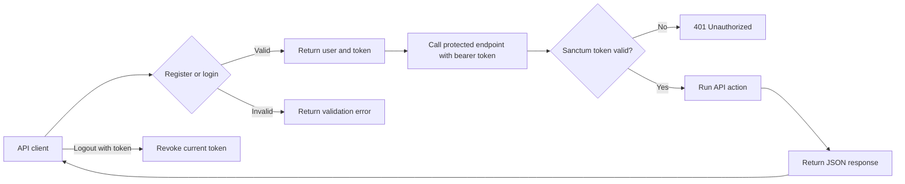
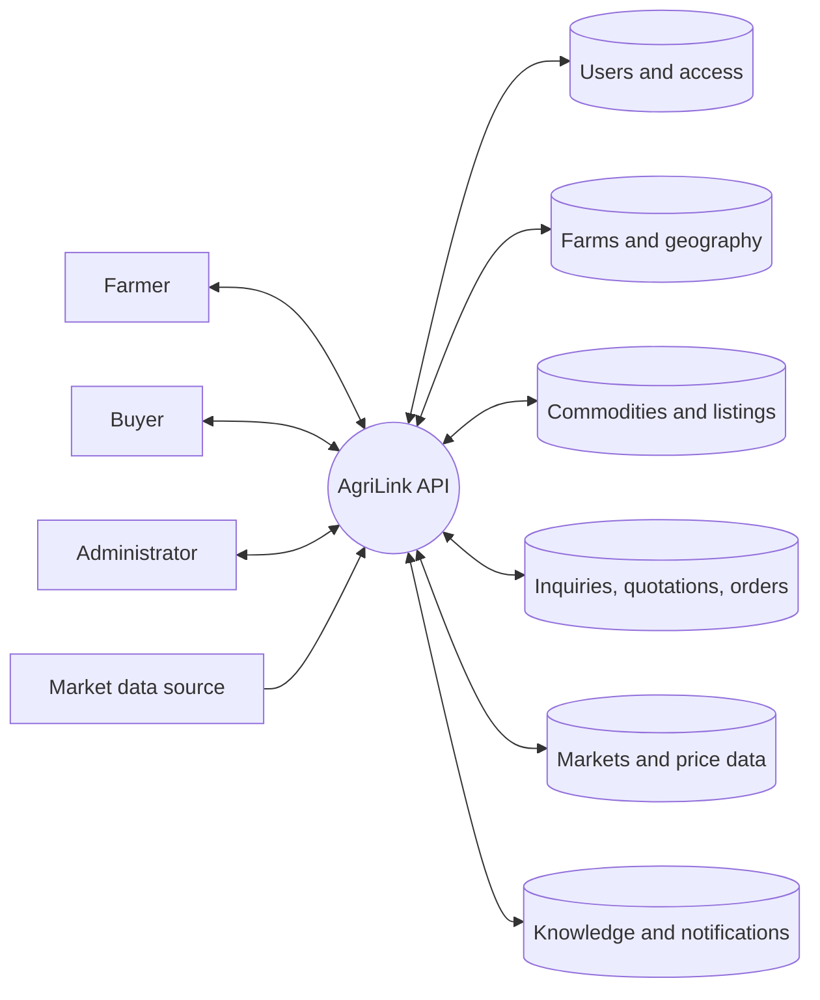
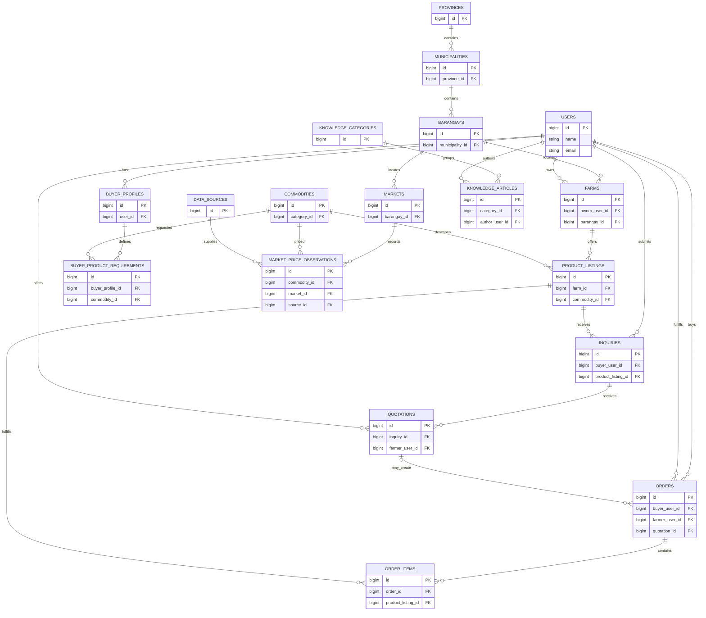

# AgriLink API

Laravel API for connecting farmers and buyers through farm listings, inquiries, quotations, and orders.

## API groups

| Prefix | Resources |
| --- | --- |
| `/api/auth` | Register, login, logout |
| `/api/buyers` | Buyer and business profiles, requirements, members |
| `/api/commerce` | Conversations, inquiries, quotations, orders, reviews |
| `/api/geography` | Provinces, municipalities, barangays, farms |
| `/api/identity` | Roles, permissions, addresses, preferences, verification |
| `/api/knowledge` | Articles, categories, assistance programs |
| `/api/market-intelligence` | Markets, sources, prices, imports, alerts |
| `/api/notifications` | Notification preferences and deliveries |
| `/api/products` | Commodities, listings, categories, images, saved listings |

Registration and login are public. All other API routes require a Sanctum bearer token:

```http
Authorization: Bearer <token>
Accept: application/json
```

## Authentication flow



## Data flow diagram



## Entity relationship diagram

Core business relationships from the database migrations. The migrations define the complete schema, including supporting tables and fields.


